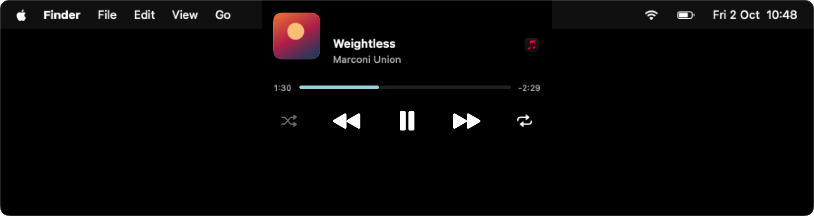
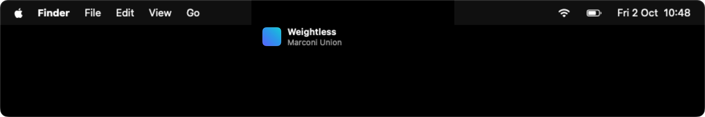
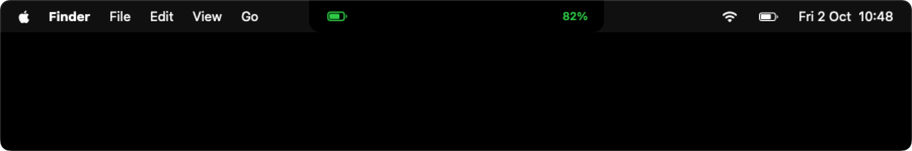
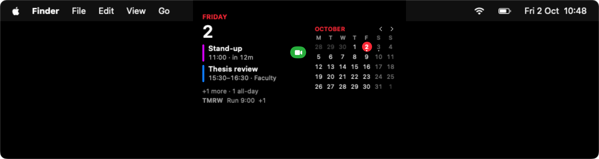
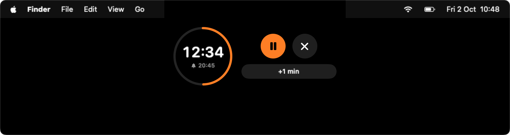
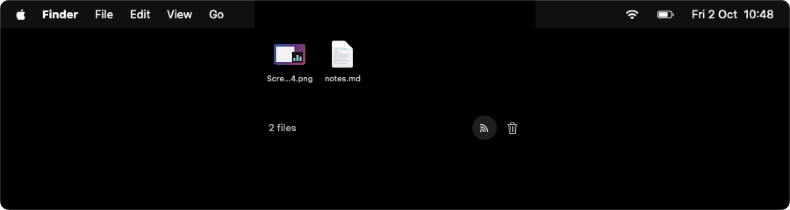
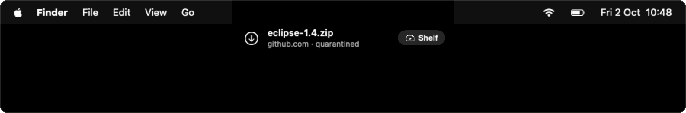
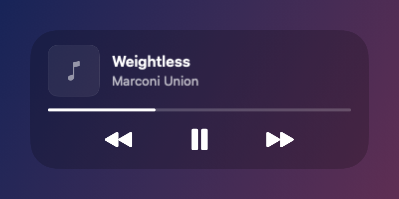

# Eclipse



`macOS 15+` `Apple silicon and Intel` `GPL v3`

A notch app for macOS that I built for myself. It shows what plays, holds files you drop on it, keeps your next event and your timer in view, and stays out of the way. No accounts, no server, no telemetry.

I am an early-career engineer and this is a personal project. It works well on my Mac every day, but it has not been tested on many others yet. Bug reports are welcome.

## Features so far

### Now playing

Hover over the notch or click it to open the player for Apple Music, Spotify or web video, with the website named for Safari videos. When a new track starts, the closed notch shows it for a moment, then keeps its artwork and a small wave while it plays.



### Indicators

Volume, brightness, Caps Lock, Focus, charging and audio devices show briefly beside the camera. With Accessibility allowed, they replace the macOS volume and brightness pop-ups.



### Calendar

Today's events and the month, with a Join button for video calls. A countdown appears before the next event, and an optional reminder says when it is time to leave.



### Timer

Set a timer by scrolling on the dial or with a preset. While it runs, the time left stays in the closed notch.



### Shelf

Drop files and screenshots on the notch to keep them for later, then drag them out or send them with AirDrop. An optional clipboard history keeps what you copied.



### Screenshots and downloads

A new screenshot drops down from the notch to open, shelve or drag. Optional download alerts show each finished file with the site it came from and whether macOS quarantined it.



### Lock screen

While the Mac is locked, a lock sits in the notch and a media widget with controls shows what plays. Drawing above the lock screen needs a private macOS framework, so this is the feature most likely to break in a macOS update.



Swipe gestures open, close and page the notch, and almost every part can be turned off or tuned in Settings, including which display the notch appears on. The images come from the app's render mode with demo data (`scripts/render.sh`).

## Requirements

- macOS 15 or later. I test on macOS 27 on an M2 MacBook Air; older versions build but get less testing.
- A Mac with a notch looks best. On a Mac without one, or on an external display, Eclipse draws a black notch at the top center of the screen. You choose the display and the notch width in Settings.
- Xcode 26 or later, the full app from the App Store. The Command Line Tools alone are not enough.
- Apple silicon or Intel. The build targets the Mac it runs on. I have not tested Intel.

## Install

```sh
curl -fsSL https://raw.githubusercontent.com/AndreiStolojan/Eclipse/main/install.sh | bash
```

The script checks your macOS version and Xcode, downloads the source to `~/Library/Caches/eclipse-install`, builds it, installs Eclipse to `/Applications` (or `~/Applications`) and opens it. The first build takes a few minutes. Run the same command again to update. It never uses `sudo`.

From a clone, `./install.sh` builds and installs that checkout instead.

To uninstall:

```sh
curl -fsSL https://raw.githubusercontent.com/AndreiStolojan/Eclipse/main/install.sh | bash -s -- --uninstall
```

The app is built on your Mac and signed ad hoc, because I do not have an Apple Developer ID yet. I do not distribute prebuilt copies; everyone builds their own from source. macOS cannot check an ad hoc app the way it checks a notarized one, and it treats every update as a new app, so you allow its permissions again after each update. A signed, notarized release is planned.

If you used an earlier build of Eclipse, allow its permissions once more after updating, and allow Keychain access if macOS asks about the Spotify or T3 Code sign-in. Earlier builds used a weaker signing setup that kept permissions across updates; the next section explains the safer way to keep them.

### Keep permissions across updates

macOS ties permissions to the app's signature. With your own certificate, the signature stays the same across builds, so the permissions stay too:

1. Open Keychain Access, then Keychain Access > Certificate Assistant > Create a Certificate.
2. Name it, for example, "Eclipse Local Signing". Set Identity Type to Self Signed Root and Certificate Type to Code Signing.
3. Install with `ECLIPSE_CODESIGN_IDENTITY="Eclipse Local Signing" ./install.sh`. With the curl command, put the variable before `bash`: `curl -fsSL .../install.sh | ECLIPSE_CODESIGN_IDENTITY="Eclipse Local Signing" bash`.

Only builds signed with that certificate inherit the permissions. Keep the certificate's private key in your login keychain and do not export it.

## Beta channel

New features land on the `beta` branch first. To try them:

```sh
curl -fsSL https://raw.githubusercontent.com/AndreiStolojan/Eclipse/main/install.sh | bash -s -- --beta
```

This installs a separate app called Eclipse Beta, with its own settings and permissions, so it can sit next to the stable one. Run only one of them at a time, since both draw in the same notch. `--beta --uninstall` removes it.

## Permissions

Eclipse asks for Accessibility once at first launch and for the rest when a feature first needs them. You can say no to any of them; only the feature that needs it stops working.

| Permission | What it is for |
| --- | --- |
| Accessibility | Taking over the volume and brightness keys, the Caps Lock indicator, and Like and tab titles in browsers other than Safari and Chrome |
| Automation | Reading Safari's and Chrome's tab titles to name the website playing, and Like and Playlist in Apple Music and Spotify |
| Calendars | The calendar page and the countdown |
| Location | Time to leave, which measures travel time to an event's place |
| Full Disk Access | Reading the current Focus mode, which macOS keeps in a protected folder |
| Desktop or Downloads folder | Watching for new screenshots, and for downloads if you turn download alerts on |

## Privacy

Eclipse has no accounts, no server, no analytics and no telemetry. Settings stay in your Mac's preferences, sign-ins stay in your login Keychain. It only goes online for:

- the favicon of the website playing media, fetched from that website;
- Spotify artwork and, if you set up Spotify, its Web API for Like and Playlist;
- Apple Maps travel times, only when time to leave is on and an event has a place.

## Spotify

Eclipse does not ship a Spotify app key. To use Like and Playlist with Spotify, you register your own app with Spotify. Since February 2026, Spotify only runs such apps (Development Mode) while their owner has an active Spotify Premium subscription. If your Premium lapses, Like and Playlist on Spotify stop working until you subscribe again; playback and everything else in Eclipse keep working.

1. Open the [Spotify developer dashboard](https://developer.spotify.com/dashboard) and create an app.
2. Add the redirect URI `http://127.0.0.1:43821/callback` and select the Web API.
3. Copy the app's Client ID into Eclipse, under Settings, Now Playing, Spotify, and press Save.
4. Press Like on a Spotify track. Your browser opens Spotify's consent page once.

Eclipse uses the authorization code flow with PKCE, so there is no client secret. The Client ID and the tokens stay in your login Keychain. Without a Client ID, the Spotify Like and Playlist buttons stay dimmed and everything else works. Forget removes the Client ID and signs you out.

## Optional integrations

Both are off by default and Eclipse works fully without them.

- **Dictation, with Sotto.** [Sotto](https://github.com/AndreiStolojan/Sotto) is my dictation app, and the two are made to work together. With Settings, Sotto, Connect turned on, Eclipse shows Sotto's recording in the notch instead of Sotto's bottom pill, through a local socket that only your user can reach ([docs/socket.md](docs/socket.md)).

  
- **Agent threads, with T3 Code.** T3 Code is a coding agent app. With Settings, T3 Code, Connect turned on, the notch shows when an agent thread finishes or needs an answer ([docs/t3-code.md](docs/t3-code.md)).

## Building from source

```sh
git clone https://github.com/AndreiStolojan/Eclipse.git
cd Eclipse
./scripts/build.sh     # Release build in .build/, add --beta for Eclipse Beta
./scripts/check.sh     # logic checks, no permissions needed
./scripts/render.sh    # renders the views from demo data to .build/renders
```

To work in Xcode, open `NotchLab.xcodeproj` and run the `Eclipse` scheme. The project and the bundle ID (`ro.andrei.NotchLab`) keep the app's old name, Notch Lab, so settings survive across versions. The only dependency, MediaRemoteAdapter, is fetched by Swift Package Manager at a pinned commit.

## Known limits

- **Private APIs.** macOS has no public API for what another app is playing. Eclipse reads it through [MediaRemoteAdapter](https://github.com/Beingpax/mediaremote-adapter), which reaches the private MediaRemote framework through the system's Perl interpreter. The lock screen widget and fullscreen detection use the private SkyLight framework, and the brightness indicator uses the private DisplayServices framework. Apple can break any of these in a macOS update. When a lookup fails, that feature turns off and the rest keeps working.
- **Ad hoc signing.** Without a certificate, each update asks for permissions again. With your own certificate (see above), only builds signed with it get them.
- **Name clash.** The Eclipse IDE also installs as `Eclipse.app`. If it is in `/Applications`, the installer puts this Eclipse in `~/Applications` and never touches the IDE.
- **Testing.** Real-world testing so far is one Mac. Media apps, browsers and external display setups I do not use may behave differently.

## Credits and license

Eclipse is licensed under the [GNU General Public License v3](LICENSE). Parts are adapted from [boring.notch](https://github.com/TheBoredTeam/boring.notch) (GPL v3) and [SkyLightWindow](https://github.com/Lakr233/SkyLightWindow) (MIT), and it uses [MediaRemoteAdapter](https://github.com/Beingpax/mediaremote-adapter). Part of that dependency has no license yet, so this repository ships source only: you build the app yourself and no prebuilt copies are distributed. See [NOTICE.md](NOTICE.md) for details.

## Contributing

Issues and pull requests are welcome. See [CONTRIBUTING.md](CONTRIBUTING.md). To report a security problem, see [SECURITY.md](SECURITY.md).
