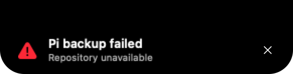
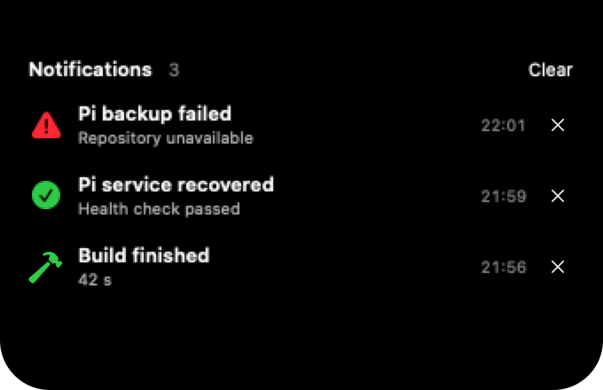
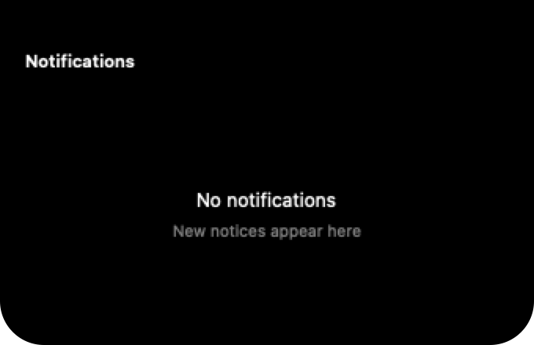

# CLI notices and Pi failures

Andrei chose variant C on 22 October 2026. Implemented on
`feat/cli-notice-design`, based on beta `b7550e3`. No commit, push, installation
or production configuration change was made.

## What changed

- Script notices have an independent, off-by-default setting under Connected
  apps > Scripts. Sotto still needs its own opt-in for dictation.
- Validated socket messages now reach temporary alerts and a Notifications
  page. The queue holds at most eight alerts; history holds twenty entries
  in memory. Matching IDs update a row, and identical repeats do not re-alert.
- Alerts count eight seconds of visible time, pause during hover or higher
  priority activity, and expire after sixty seconds in the queue. Overflow
  drops the oldest waiting alert. History keeps the latest twenty entries.
- Dictation, screenshots, downloads, system indicators, timer completion,
  T3 alerts and calendar Quick Peeks retain priority. Locking discards pending
  alerts. Notices received while locked or asleep enter history without
  alerting on return. Disabling notices clears history.
- `notch --stdin` accepts one bounded notify object and rejects dictation,
  invalid JSON, extra lines and oversized input before opening a socket.
- [Pi notices](../pi-notices.md) documents stable failure/recovery IDs and
  fixed-command SSH delivery with JSON on stdin. No new listener, key,
  service setting or retry daemon was added.

The baseline inspection confirmed that the parser and CLI existed, but
`onNotice` had no consumer. The socket previously opened only for Sotto.
GitHub was rechecked before implementation; no open PR existed. Beta,
rather than main, is the contribution base required by CONTRIBUTING.md.

## Design evidence

The original three proposals remain in [notify-options.html](notify-options.html).
Andrei selected C before changes to the app.

Before:

After:

These are native SwiftUI renders from demo data, not screenshots of an
installed app. Timestamps are fixed arrival times, avoiding idle redraws.

## Validation

Validation uses the existing SSH route to the Mac and an isolated temporary
source copy at `/tmp/eclipse-notices.YpkkZl`. Existing Mac checkouts and the
installed Eclipse are untouched. Only the temporary Render executable ran
in fixture mode, under its separate `.render` bundle ID.

- `scripts/check.sh` passed on macOS, including queue replacement, bounded
  memory, expiry, dictation/timer priority, hover, opt-in separation and
  lock privacy. The final run is recorded in `.checks-final.log` in the
  temporary Mac directory.
- The real-socket checks verified the private 0700 folder and 0600 socket,
  same-user notice delivery, rejection of dictation without the Sotto
  opt-in, enabling and disabling dictation, continued notices, and cleanup.
- Four CLI integration tests passed against isolated Unix sockets. They
  cover cleaned JSON delivery, invalid input, mixed modes and absent sockets.
- `scripts/build.sh --beta` passed, including signature validation and CLI
  compilation. No built app was installed or opened interactively.
- `scripts/render.sh` ran before and after the change. Selected after
  images were inspected; the progress line was corrected to stay two points
  high. The renderer logged a nonfatal sandbox-extension warning and still
  exited successfully and generated the images.
- A notice sent from this Pi through SSH reached the temporary Mac CLI and
  an isolated test socket. The installed app was not contacted. The payload
  is in `.build/ssh-transport.json` in the temporary Mac directory.
- `git diff --check` passed. T3's HTML preview continued timing out after
  twenty seconds; the native PNGs were inspected directly. The earlier
  Artifact publication succeeded but returned no public URL.

## Checkpoint

Completed: variant C, focused checks, Release build, before/after native
renders, documented producer contract and isolated SSH transport validation.
No quota error or reset time was reported.

Remaining: manual hover/click and scrolling on the physical notch, real
Sotto recording and timer overlap, lock/unlock and sleep/wake checks. A build
and fixture renders cannot prove those behaviours. No further design choice
is pending. Enabling delivery from an actual Pi backup/service remains with
that project's worker and its authorization; this thread edits Eclipse only.

Exact next action: review the diff and perform the physical Mac checks before
installation or a PR. The producer should keep failures in its own records;
a successful socket write is not a display or durable-delivery acknowledgement.
